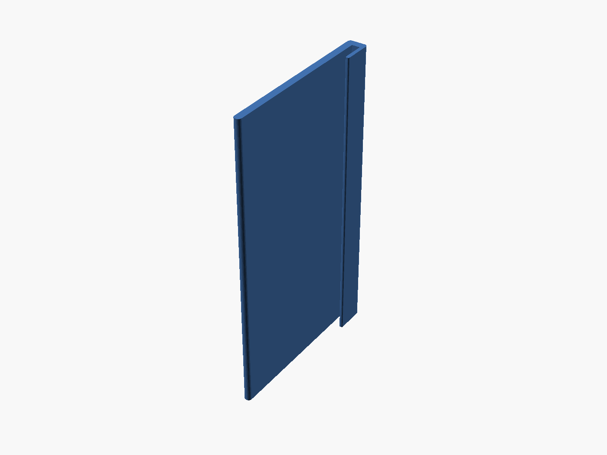
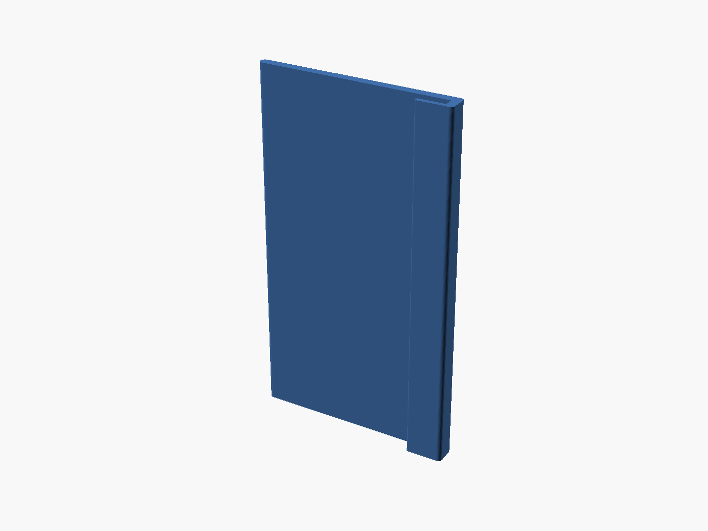
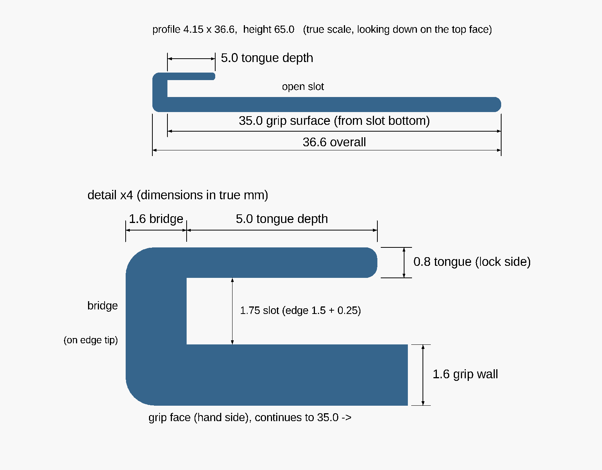

# Door Protective Sleeve

A parametric, 3D-printable protective sleeve for the worn gripping edge of an aluminum sliding door.

## Purpose

The gripping edge of the sliding door's aluminum frame is worn and damaged where hands pull the door open. The sleeve covers that edge with a smooth printed surface.

The sleeve is a U-shaped channel with three functional surfaces:

1. **Grip face**: covers the inside hand-gripping surface.
2. **Edge bridge**: wraps the worn 1.5 mm aluminum edge.
3. **Retaining tongue**: a thin wall that goes into the frame's internal channel, alongside the door lock, to locate the sleeve.

It is installed mechanically for fit testing first. Once the fit is confirmed, it will probably be bonded to the aluminum permanently with epoxy or cyanoacrylate, so the tongue only locates the part and does not clamp it.

## Status

**Current approved design: the finished 65 mm sleeve.** Its cross-section passed a physical fit test as a 15 mm specimen. The 65 mm part is exported but not yet printed.

Opening `src/sleeve.scad` shows this design by default. The exports and images below are regenerated from it.

### Current design and fit-test prototype

| | Current design (65 mm) | Fit-test prototype (15 mm, historical) |
|---|---|---|
| Source | `src/sleeve.scad` (default) | `src/sleeve.scad` with `-D sleeve_height=prototype_height` |
| STL | `exports/sleeve.stl` | `exports/sleeve-test.stl` |
| 3MF | `exports/sleeve.3mf` (OpenSCAD geometry export, no print settings) | `exports/sleeve-test.3mf` (**Bambu Studio print project** with the settings that printed the passing specimen) |
| Images | `photos/sleeve-iso.png`, `sleeve-profile.png`, `sleeve-tongue.png`, `sleeve-section.png` | `photos/sleeve-test-iso.png`, `sleeve-test-profile.png`, `sleeve-test-tongue.png` |

The prototype files are kept as the record of what was printed and tested. They are not regenerated.

### Fit test

A 15 mm PLA test specimen was printed and tried on the door. All three functional tests passed:

1. The retaining tongue fits into the frame channel.
2. The 35 mm grip face sits properly against the door.
3. The locking mechanism operates normally with the sleeve in place.

The slot is slightly loose in places, because the damaged aluminum edge varies in thickness. That is acceptable, and the extra room may help hold adhesive.

The finished 65 mm part (`exports/sleeve.stl`, `exports/sleeve.3mf`) uses exactly the same cross-section, extruded to full height. Its remaining checks are listed under [Remaining full-height validation](#remaining-full-height-validation).

## Design and features





- One connected U-shaped solid: a constant cross-section extruded along the door edge
- Grip face covering the full measured 35 mm hand surface
- Bridge seated on the aluminum edge tip
- 0.8 mm retaining tongue, 5.0 mm deep, sized for the measured 1.5 mm lock clearance
- Rounded exposed corners: 0.75 mm on the bridge and grip tip, 0.3 mm on the tongue tip
- The rounded grip and tongue tips act as lead-ins when the sleeve is started onto the edge
- It can be pushed straight on, slid on from one end, or started at an angle and rotated on. No snap-fit.
- The top and bottom end faces are deliberately left square. See [End faces](#end-faces).

### Cross-section




Second image: blue is the sleeve. Grey is the 1.5 mm aluminum edge, with the grip face against its outer surface (the bonded position). Red is where the lock face would be, according to the 1.5 mm clearance measurement. Only that one gap is modelled; the lock's real shape is not.

```
          bridge
    +----------------+          bridge top
    |  +----------+  |          slot bottom / edge tip
    |  | aluminum |  | tongue
    |  |  edge    |  |
    |  |          +--+          tongue tip, 5.0 below the edge tip
    |  |           .
    |  |           .  lock side (inside the frame channel)
    |  |
    +--+                        grip tip, 35.0 below the edge tip
    grip face (hand side)
```

### Door (as measured)

| Parameter | Value |
|---|---|
| Aluminum frame edge thickness | 1.5 mm (varies along the damaged edge) |
| Edge tip to bottom of internal frame channel | 6.0 mm |
| Clearance between channel wall and locking mechanism | 1.5 mm |
| Inside hand-gripping surface length | 35.0 mm |
| Required finished protector height | 65.0 mm |

The 1.5 mm lock clearance is the most critical constraint.

### Sleeve (cross-section fit-tested at 15 mm)

| Parameter | Value | Source |
|---|---|---|
| Grip-face wall | 1.6 mm | fit-tested |
| Internal slot width | 1.75 mm | fit-tested; slightly loose in places |
| Retaining tongue thickness | 0.8 mm | fit-tested |
| Tongue insertion depth | 5.0 mm, measured from the edge tip | fit-tested |
| Bridge thickness | 1.6 mm | fit-tested |
| Grip-face coverage | 35.0 mm, measured from the edge tip | fit-tested |
| Overall cross-section | 4.15 mm × 36.6 mm | derived |
| Test specimen height | 15.0 mm | printed and tested |
| Finished height | 65.0 mm | exported, not yet printed |

### Clearance budget

| Check | Value |
|---|---|
| Slot play around the edge | 1.75 − 1.5 = **0.25 mm** (nominal; more where the edge is thinner) |
| Tongue-to-lock gap, tongue pulled against the aluminum | 1.5 − 0.8 = **0.70 mm** |
| Tongue-to-lock gap, grip face against the aluminum (bonded) | 1.5 − 0.25 − 0.8 = **0.45 mm** |
| Gap below the tongue tip in the channel | 6.0 − 5.0 = **1.0 mm** |

Bonding the grip face to the aluminum puts all of the slot play on the lock side. In that case the theoretical 0.7 mm lock clearance drops to **0.45 mm**. Where the damaged edge is thinner than 1.5 mm, the gap drops further. The lock operated normally with the 15 mm specimen fitted, but that test was not done with the part bonded.

The model refuses to render if the tongue plus slot play no longer fits inside the measured lock clearance, if the tongue is deeper than the channel, or if a corner radius is too large for its wall.

### End faces

The top and bottom end faces of the extrusion are left square on purpose. Rounding them was considered for hand comfort and rejected:

- The bottom end is the bed footprint: only 66 mm² holding up a 65 mm-tall, thin part. Rounding it would shrink that footprint and add an overhang where adhesion matters most.
- A rounding pass that reached the slot or tongue would change the proven fit at both ends. Rounding only the exterior would need new construction that the fit test never covered.

If the end edges feel sharp, a light deburr with a file or fine sandpaper after printing does the same job without touching the model.

## Remaining full-height validation

The 15 mm test proved the cross-section at one place on the edge. These checks are still open for the 65 mm part:

- **Fit over the full length.** Edge thickness, channel depth and the 1.5 mm lock clearance have not been confirmed along all 65 mm. The edge is already known to vary in thickness.
- **Lock operation with the full-length part.** Run the lock through its full travel with the 65 mm sleeve fitted, before bonding.
- **Lock operation after bonding.** Gluing the grip face to the aluminum moves all of the slot play to the lock side (see [Clearance budget](#clearance-budget)). Recheck the lock after the adhesive has cured, ideally with a dry-fit check first.
- **Vertical position.** Confirm where the 65 mm span sits relative to the lock, and that no lock feature lies within it that the 15 mm test missed.
- **Print straightness.** A 65 mm-tall thin part can bow or ring at the top. Check that the printed tongue and slot are straight over their full height.
- **Adhesive.** Choice of adhesive, surface preparation and glue-line thickness are not yet specified.

## Printing and use

The 15 mm fit-test specimen was printed with these settings (recorded in `exports/sleeve-test.3mf`):

| Setting | Value |
|---|---|
| Printer | Bambu Lab P1S, 0.4 mm nozzle |
| Slicer | Bambu Studio 02.08.02.61 |
| Process | 0.20 mm Standard (0.20 mm layers, 2 wall loops, classic wall generator) |
| Filament | Bambu PLA Matte |
| Plate | Textured PEI |
| Supports | none |
| Brim | auto |
| Elephant's foot compensation | 0.15 mm |
| Orientation | as modelled: U cross-section flat on the plate, part standing upright |

For the 65 mm part:

- **Print in the same upright orientation**, with the U cross-section on the plate and the part standing 65 mm tall. This is the orientation that produced the proven fit. Every wall thickness is set in XY, the same way as in the test. The tongue's root is formed within each layer rather than across layers, so it is not relying on layer adhesion to hold.
- Use the same process and filament settings as the test, so that the cross-section prints the same way.
- The footprint is small for the height (66 mm²). In the slicer preview, check whether auto brim adds a brim. If it does, make sure the brim does not fill the 1.75 mm slot or wrap the tongue, because that would have to be cut out of the slot. Brim ears on the outside corners, or no brim on a clean textured plate, avoid the problem.
- No supports are needed.
- Lying the part on its bridge or grip face is not recommended. On the grip face, the tongue overhangs the slot and needs support inside it. On the bridge, the tongue's root is formed across layers and is weak in bending.
- Measure the printed tongue and slot with calipers at both ends and the middle before fitting.
- Dry-fit the full-length part and check the lock before applying any adhesive.

## Verification

These checks were done in OpenSCAD 2021.01. They cover both heights, rendered from the same cross-section:

- **Single solid:** a forced CGAL Nef render reports `Simple: yes`, one solid volume, V − E + F = 2 at both 15 mm and 65 mm.
- **Watertight mesh:** in the exported STLs every edge is shared by exactly two triangles, with consistent orientation and one connected shell.
- **Dimensions:**
  - 15 mm: 4.15 × 36.6 × 15.0 mm, volume 991.6 mm³ against 991.8 mm³ calculated by hand.
  - 65 mm: 4.15 × 36.6 × 65.0 mm, volume 4296.9 mm³, which is exactly 65/15 of the test part.
- **Cross-section identity:** the 65 mm STL has the same 56 profile points as the proven 15 mm STL, vertex for vertex. Only the Z extent differs.
- **Interference probes** (0.001 mm offsets), at full height:
  - The slot interior is empty.
  - The 0.8 mm tongue band is solid, and nothing lies beyond it.
  - The aluminum dummy fits in the slot.
  - The worst-case lock face is clear.
- **Reproducibility:**
  - The source default exports byte for byte as `exports/sleeve.stl`.
  - The explicit test configuration still exports byte for byte as the fit-tested `exports/sleeve-test.stl`.
  - `exports/sleeve.3mf` holds the same 112 vertices as the STL, to within the 3MF's six-decimal rounding.
- A tongue too thick for the lock clearance stops the render with an assertion.

The `aluminum_dummy()` and `lock_face_dummy()` calls at the bottom of `src/sleeve.scad` can be uncommented to show the fit in the preview.

### Regenerating the exports and images

From the repository root, in Git Bash:

```
sh scripts/regenerate.sh
```

It rewrites the current design's exports (`exports/sleeve.stl`, `exports/sleeve.3mf`) and images (`photos/sleeve-*.png`) from `src/sleeve.scad`. The dimensioned drawings come from `src/sleeve-drawing.scad`, which includes the real source, so their labels always match it. The script leaves the historical prototype files alone. Its last step checks that the current cross-section still reproduces the fit-tested `exports/sleeve-test.stl`, and reports if it no longer does.

The 15 mm test configuration can still be rebuilt on demand. Write it to a new file name rather than over the record:

```
openscad -D sleeve_height=prototype_height -o sleeve-15mm.stl src/sleeve.scad
```

## Limitations and warnings

- The door dimensions come from one set of measurements of one door. The fit test was done at one position on the edge.
- Printer accuracy and filament shrinkage can affect fit. The lock-side clearance is deliberately small.
- A part that interferes with the lock could keep the door from locking. Confirm that the lock works through its full travel before bonding anything.
- Once the sleeve is bonded with epoxy or cyanoacrylate, it may not come off without damage.
- `src/sleeve.scad` is the source of truth. Follow the [design synchronization rule](#design-synchronization-rule) whenever it changes.

## Development approach

The sleeve is a parametric OpenSCAD model, developed with the same design-and-review loop as the [YoLink Thermometer Cradle](https://github.com/lairdrt/yolink-thermometer-cradle):

1. The design intent and measurements were set out up front, with the unmeasured geometry listed as open questions.
2. Claude (Claude Code in VS Code) edited `src/sleeve.scad` directly.
3. CGAL renders, interference probes and a bounding-box/volume check verified the geometry.
4. The cross-section was reviewed visually in OpenSCAD before printing.
5. A 15 mm specimen was printed and passed a physical fit test on the door.
6. The finished part was exported at 65 mm with the cross-section unchanged, and made the source default.

### Design synchronization rule

This is a permanent project requirement. **A design change is not complete until every derived file and the OpenSCAD GUI show the new design.** No one should have to pick parameters, reopen files or work out which version is current.

For every design change:

1. **Source:** update `src/sleeve.scad`, the single source of truth.
2. **Default:** make its default configuration the current approved design, so that opening the file shows it.
3. **Exports:** regenerate `exports/sleeve.stl` and `exports/sleeve.3mf` (`sh scripts/regenerate.sh`).
4. **Images:** regenerate the affected images and dimensioned drawings (same script).
5. **Documentation:** update this README wherever the change affects it.
6. **Verify:** confirm that the regenerated outputs match the source, using the script's check plus mesh and dimension checks.
7. **GUI:** refresh any open OpenSCAD window so that it shows the current design. "Automatic Reload and Preview" reloads the file when it is saved. Press **F5** to apply the source's default isometric view, then **F6** for the full render; F6 keeps the current camera, so do F5 first.
8. **History:** keep superseded or test versions separate and clearly labelled (`sleeve-test*`), and never regenerate them over the record. A Bambu Studio project is never replaced by a plain OpenSCAD 3MF.
9. **Report** any of these steps that could not be completed.

## Tools

| Tool | Use |
|---|---|
| OpenSCAD 2021.01 | Parametric CAD modelling and export |
| VS Code | Editing |
| Claude Code / Claude in VS Code | Source editing and verification assistance |
| Bambu Studio | Slicing |
| Bambu Lab P1S, 0.4 mm nozzle | Printing |

## Repository structure

```
src/         OpenSCAD source
               sleeve.scad                the model; defaults to the current design
               sleeve-drawing.scad        review drawings, built from sleeve.scad
scripts/     regenerate.sh                rebuilds current exports and images
exports/     Print files:
               sleeve.stl, sleeve.3mf     current: finished 65 mm part (OpenSCAD exports)
               sleeve-test.stl            historical: 15 mm fit-test specimen (OpenSCAD export)
               sleeve-test.3mf            historical: 15 mm fit-test print project (Bambu Studio)
photos/      Images:
               sleeve-*.png               current design (regenerated)
               sleeve-test-*.png          historical 15 mm prototype (kept as recorded)
```

## License

GNU General Public License v3.0. See [LICENSE](LICENSE).
