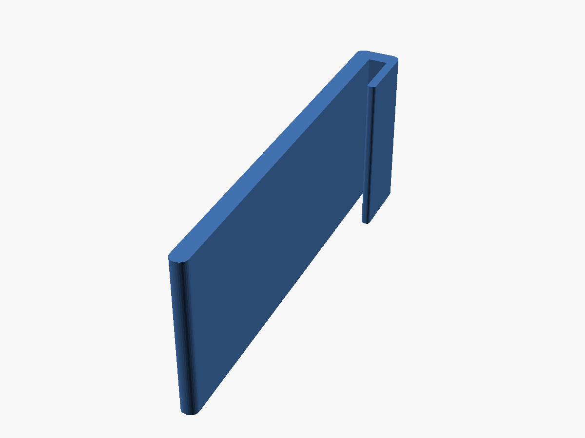

# Door Protective Sleeve

A parametric, 3D-printable protective sleeve for the worn gripping edge of an aluminum sliding door.

## Purpose

The gripping edge of the sliding door's aluminum frame is worn and damaged where hands pull the door open. The sleeve covers that edge with a smooth printed surface.

The sleeve is a U-shaped channel with three functional surfaces:

1. **Grip face**: covers the inside hand-gripping surface.
2. **Edge bridge**: wraps the worn 1.5 mm aluminum edge.
3. **Retaining tongue**: a thin wall that goes into the frame's internal channel, alongside the door lock, to locate the sleeve.

It is installed mechanically for fit testing first. Once the fit is confirmed, it will probably be bonded to the aluminum permanently with epoxy or cyanoacrylate, so the tongue only locates the part and does not clamp it.

## Status

**Not yet printed or fit-tested.** This is the first, unverified design.

- The current exports are the **15 mm fit-test specimen**, not the finished 65 mm part.
- Every sleeve dimension below is a proposed starting value, not a verified fit.
- The model has been checked in OpenSCAD only (see [Verification](#verification)).

## Design and features



- One connected U-shaped solid: a constant cross-section extruded along the door edge
- Grip face covering the full measured 35 mm hand surface
- Bridge seated on the aluminum edge tip
- 0.8 mm retaining tongue, 5.0 mm deep, sized for the measured 1.5 mm lock clearance
- Rounded exposed corners: 0.75 mm on the bridge and grip tip, 0.3 mm on the tongue tip
- The rounded grip and tongue tips act as lead-ins when the sleeve is started onto the edge
- It can be pushed straight on, slid on from one end, or started at an angle and rotated on. No snap-fit.

### Cross-section


Blue: sleeve. Grey: the 1.5 mm aluminum edge, with the grip face against its outer surface (the bonded position). Red: where the lock face would be, according to the 1.5 mm clearance measurement. Only that one gap is modelled; the lock's real shape is not.

```
          bridge
    +----------------+          bridge top
    |  +----------+  |          slot bottom / edge tip
    |  | aluminum |  | tongue
    |  |  edge    |  |
    |  |          +--+          tongue tip, 5.0 below the edge tip
    |  |           .
    |  |           .  lock side (inside the frame channel)
    |  |
    +--+                        grip tip, 35.0 below the edge tip
    grip face (hand side)
```

### Door (as measured)

| Parameter | Value |
|---|---|
| Aluminum frame edge thickness | 1.5 mm |
| Edge tip to bottom of internal frame channel | 6.0 mm |
| Clearance between channel wall and locking mechanism | 1.5 mm |
| Inside hand-gripping surface length | 35.0 mm |
| Required finished protector height | 65.0 mm |

The 1.5 mm lock clearance is the most critical constraint.

### Sleeve (proposed, not yet verified)

| Parameter | Value | Source |
|---|---|---|
| Grip-face wall | 1.6 mm | proposed |
| Internal slot width | 1.75 mm | proposed range 1.7–1.8 mm; midpoint |
| Retaining tongue thickness | 0.8 mm | proposed |
| Tongue insertion depth | 5.0 mm, measured from the edge tip | proposed |
| Bridge thickness | 1.6 mm | **not specified**; set equal to the grip wall |
| Grip-face coverage | 35.0 mm, measured from the edge tip | measured surface |
| Overall cross-section | 4.15 mm × 36.6 mm | derived |
| Test specimen height | 15.0 mm | proposed |
| Finished height | 65.0 mm | measured requirement |

### Clearance budget

| Check | Value |
|---|---|
| Slot play around the edge | 1.75 − 1.5 = **0.25 mm** |
| Tongue-to-lock gap, tongue pulled against the aluminum | 1.5 − 0.8 = **0.70 mm** |
| Tongue-to-lock gap, grip face against the aluminum (bonded) | 1.5 − 0.25 − 0.8 = **0.45 mm** |
| Gap below the tongue tip in the channel | 6.0 − 5.0 = **1.0 mm** |

Bonding the grip face to the aluminum puts all of the slot play on the lock side. In that case the theoretical 0.7 mm lock clearance drops to **0.45 mm**. Widening the slot reduces it further. At 1.8 mm the gap is 0.40 mm.

The model refuses to render if the tongue plus slot play no longer fits inside the measured lock clearance, if the tongue is deeper than the channel, or if a corner radius is too large for its wall.

## Not yet established

These are physical facts the measurements do not settle. They are left open on purpose rather than guessed:

- **Lock travel.** The 1.5 mm clearance is a single static measurement. Whether the lock's moving parts (bolt, hook, lever) sweep into that gap during locking or unlocking is not known.
- **Gap uniformity.** It is not known whether the 1.5 mm clearance holds over the full 65 mm height, or whether the 1.5 mm edge thickness and 6.0 mm channel depth hold along the whole edge.
- **Vertical position.** Where the 65 mm sleeve sits relative to the lock, and whether any lock feature lies within that span, is not established.
- **Edge condition.** Burrs, dents or flaring on the worn edge may keep the bridge from seating. The slot-bottom corners are sharp, by design.
- **Inner channel wall.** It is not known whether the aluminum's inner face is flat and parallel to its outer face over the 5 mm of tongue depth.
- **Outside clearances.** Clearance outside the grip face and above the edge tip has not been measured, for example where the door closes against its frame or the handle sits. The sleeve adds 1.6 mm to each.
- **Adhesive layer.** Glue-line thickness, surface preparation, and how adhesive in the slot changes the play are not specified.

## Printing and use

- Print with the U cross-section flat on the build plate (as modelled), so the sleeve stands up along its height. No supports are needed.
- In this orientation every wall thickness is set in XY. The 0.8 mm tongue prints as two 0.4 mm perimeters.
- Watch for first-layer squish ("elephant's foot") on the tongue and inside the slot. It reduces the clearance at one end.
- Measure the printed tongue thickness and slot width with calipers before trying the fit.
- Test-fit the 15 mm specimen. Check that it seats on the edge, and operate the lock through its full travel with the specimen in place.
- Print the finished part only after the specimen fits: `openscad -D sleeve_height=65 -o exports/sleeve.stl src/sleeve.scad`

## Verification

These checks were done in OpenSCAD 2021.01 with CGAL renders:

- The test specimen renders as a single, manifold solid with no warnings. The full 65 mm height renders the same way.
- The bounding box measures 4.15 × 36.6 × 15.0 mm. The volume is 991.6 mm³, against 991.8 mm³ calculated by hand from the section.
- Interference probes against the aluminum and lock-face dummies, with 0.001 mm offsets:
  - The aluminum fits in the slot without overlap from the grip-face side to the tongue side, and overlaps as soon as it passes either one.
  - The lock face clears the tongue at the 0.45 mm worst case and overlaps 0.001 mm beyond it.
- A tongue too thick for the lock clearance stops the render with an assertion.

The `aluminum_dummy()` and `lock_face_dummy()` calls at the bottom of `src/sleeve.scad` can be uncommented to show the fit in the preview.

## Limitations and warnings

- The door dimensions come from one set of measurements of one door.
- Printer accuracy and filament shrinkage can affect fit. The lock-side clearance is deliberately small.
- A part that interferes with the lock could keep the door from locking. Confirm that the lock works through its full travel before bonding anything.
- Once the sleeve is bonded with epoxy or cyanoacrylate, it may not come off without damage.
- `src/sleeve.scad` is the source of truth. Regenerate the STL and 3MF exports whenever it changes.

## Development approach

The sleeve is a parametric OpenSCAD model, developed with the same design-and-review loop as the [YoLink Thermometer Cradle](https://github.com/lairdrt/yolink-thermometer-cradle):

1. The design intent and measurements were set out up front, with the unmeasured geometry listed as open questions.
2. Claude (Claude Code in VS Code) edited `src/sleeve.scad` directly.
3. CGAL renders, interference probes and a bounding-box/volume check verified the geometry.
4. Next: a physical fit test of the 15 mm specimen will correct the proposed dimensions.

## Tools

| Tool | Use |
|---|---|
| OpenSCAD 2021.01 | Parametric CAD modelling and export |
| VS Code | Editing |
| Claude Code / Claude in VS Code | Source editing and verification assistance |

## Repository structure

```
src/         OpenSCAD source (sleeve.scad)
exports/     Print files (sleeve-test.stl, sleeve-test.3mf - 15 mm specimen)
photos/      Render and cross-section images
```

## License

GNU General Public License v3.0. See [LICENSE](LICENSE).
